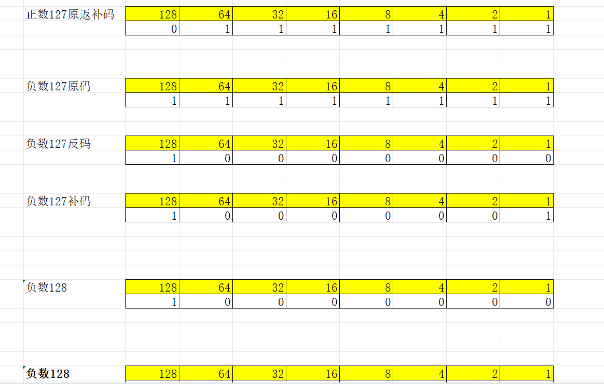
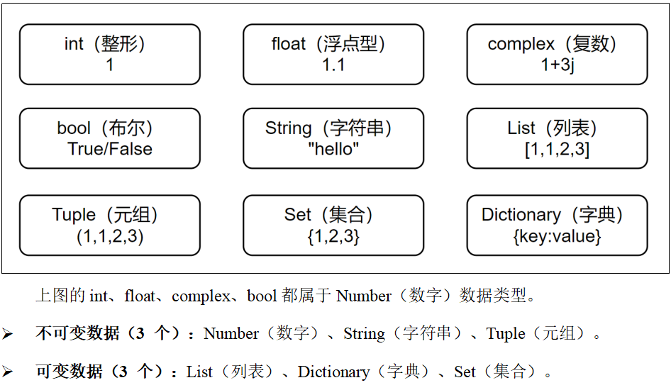
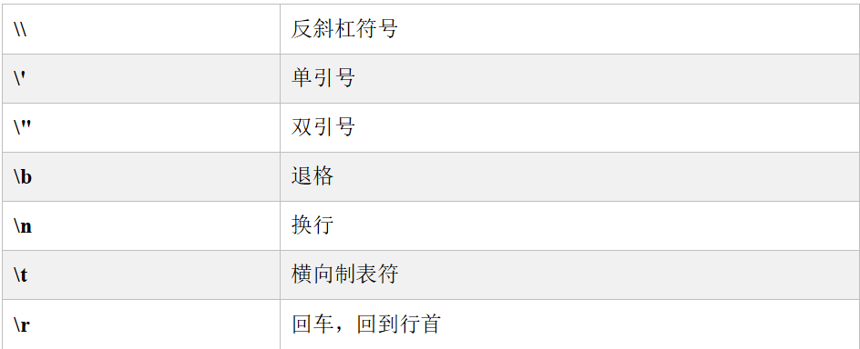

## day02

### 1. 原码、反码、补码

> `计算器的世界中，是以补码形式表示所有的整数的。`
>
> `正数的源码补码都相同，三码合一。`
>
> 原码：最高位作为符号位，如果是0则表示正数，如果为1，则表示负数。其余各位为计数位。
>
> 原码即我们人看的最直观的表示形式。
>
> 反码：在原码的基础上，符号位不变，其余各位取反(是0改为1，是1改为0)。
>
> 补码：在反码的基础上 + 1



### 2. 数据类型



#### 2.1 int类型

> int类型 数值类型
> type(数据/变量) 返回传入数据的类型
> isinstance()判断某个对象是否属于某个类型  返回的是bool 布尔类型
> 如果属于某个类型 则结果为True  否则 结果为False
>
> Python中bool类继承了int 类 属于int类的子类
> 面向对象思想中 子类与父类属于is-a的关系 即子类是父类 所以使用isinstance判断成立

```python
"""
    int类型 数值类型
    type(数据/变量) 返回传入数据的类型
    isinstance()判断某个对象是否属于某个类型  返回的是bool 布尔类型
    如果属于某个类型 则结果为True  否则 结果为False

    Python中bool类继承了int 类 属于int类的子类
    面向对象思想中 子类与父类属于is-a的关系 即子类是父类 所以使用isinstance判断成立

"""

a1 = 1_000_000_000_000
print(a1)

b = 100
print(type(b)) # int

print(isinstance(b,int)) # True


c = True
print(type(c))  # bool
print(isinstance(c,bool)) # True 可以直接判断本类类型
print(isinstance(c,int)) # True 还会判断父类类型

# 在C语言中 是没有布尔类型 使用1表示True 使用0表示False Python底层实现本身就是C语言 所以继续沿用这个设计
# 但是在Python中新增一个类型 bool
print(True + 1)
print(False + 1)


print("*" * 100)

d = 100
print(isinstance(d,bool)) # False

print("*" * 100)

e = 100
f = False
# ==表示判断是否成立
print(type(e) == type(f)) # False

```

#### 2.2 小整数池

> 小整数池
> 范围 -5 ~ 256 这个范围以内的 正数 会自动从小整数池中获取 所以相同取值的变量 指向的是内存中的
> 同一个对象 所以地址值相同 使用id()函数可以获取相同的地址值
> 使用==比较为True  使用is比较也为True
>
>
> 在PyCharm中 一个模块文件 直接运行 统一进行编译(.py文件会被编译为.pyc文件)执行的时候 检测到有相同的字面量
> 会进行常量折叠：即处理为在内存中使用同一个对象

````python
"""
    小整数池
    范围 -5 ~ 256 这个范围以内的 正数 会自动从小整数池中获取 所以相同取值的变量 指向的是内存中的
    同一个对象 所以地址值相同 使用id()函数可以获取相同的地址值
    使用==比较为True  使用is比较也为True


    在PyCharm中 一个模块文件 直接运行 统一进行编译(.py文件会被编译为.pyc文件)执行的时候 检测到有相同的字面量
    会进行常量折叠：即处理为在内存中使用同一个对象
"""

a = 100
b = 100
c = 100

print(id(a))
print(id(b))
print(id(c))

# ==比较 默认比较值
print(a == b)
print(b == c)


print("-" * 100)
# is比较 比较内存中的地址
print(a is b)
print(a is c)
print(b is c)

print("-" * 100)

d = 300
e = 300
print(d == e) # True

print(d is e) # True

print(id(d) , id(e)) # 相同 1411824327152 1411824327152
````

#### 2.3 浮点类型

> float用于表示浮点数  属于近似值 无法表示精确值  很多语言中的float 或者 double
> 都采用了相同的计数规范 IEEE754 浮点数运算标准

```python
"""
    float用于表示浮点数  属于近似值 无法表示精确值  很多语言中的float 或者 double
    都采用了相同的计数规范 IEEE754 浮点数运算标准
"""
# 从decimal模块中导入Decimal 这个类
from decimal import Decimal

f1 = 0.1
f2 = 0.2
print(f1 +  f2) # 0.30000000000000004

f3 = 1.0
f4 = 0.1
print(f3 - f4) # 0.9


f5 = 0.9
print(f3 - f5) # 0.09999999999999998

print("-" * 100)

d1 = Decimal("0.1")
d2 = Decimal("0.2")
print(d1 + d2)

d1 = Decimal("5765757687687.11215415241454152416541022653205635263520")
d2 = Decimal("89679878978978987.45165964525461252341263451065341634563522")
print(d1 + d2)

print("-" * 100)

f6 = 10000000000000000

# 3E5 3 * 10 ^ 5
f7 = 3E6
print(f7)

f8 = 3000000

f9 = 3.1415926E300
print(f9)
```

#### 2.4 bool类型

> bool 布尔 boolean   表示真True 或者假False
> True以及False 在Python属于特殊的对象 属于全局单例对象 GSI Global Single Instance
> 表示在整个Python进程中 所有的True都是内存中的同一个对象 所有的False也是
> 因为bool不可变 所以可以被共享

```python
"""
    bool 布尔 boolean   表示真True 或者假False
    True以及False 在Python属于特殊的对象 属于全局单例对象 GSI Global Single Instance
    表示在整个Python进程中 所有的True都是内存中的同一个对象 所有的False也是
    因为bool不可变 所以可以被共享
"""


n1 = None
n2 = None
print(n1 is n2)

print("-" * 100)

f1 = False
f2 = False
print(f1 is f2)


b1 = True
b2 = True
b3 = True

print(b1 is b2)
print(b2 is b3)


b4 = False
print(b1, b2)

b3 = 10 < 5
print(b3) # False

# 当我们使用True 或者 False 进行数学计算 Python解释器会先将True转换为1 False 转换为0 然后再进行计算
print(True + 1)
print(False + 1)


print("*" * 100)

print(True == 1)
print(False == 0)

# SyntaxWarning: "is" with 'int' literal. Did you mean "=="? 不推荐使用is比较int类型的数值
# print(True is 1) # False
# print(False is 0) # False


```

> 在Python中能够当做False使用的 数据
> None
> 0
> 0.0
> False
> 所有的空容器（空列表、空元组、空字典、空集合、空字符串）
>
> 在IDE中灰色的代码：
> ​    1.写了没有意义(写了却没有使用)
> ​    2.写了执行不到

```python
"""
    在Python中能够当做False使用的 数据
    None
    0
    0.0
    False
    所有的空容器（空列表、空元组、空字典、空集合、空字符串）

    在IDE中灰色的代码：
        1.写了没有意义(写了却没有使用)
        2.写了执行不到

"""

if not 10 < 5:
    print("条件成立1")


if not None:
    print("条件成立2")

if not 0:
    print("条件成立3")

if not 0.0:
    print("条件成立4")

if not "":
    print("条件成立5")

if not []:
    print("条件成立6")

if not ():
    print("条件成立7")

if not {}:
    print("条件成立8")

if not set():
    print("条件成立9")


# 以上 元素 可以当做False 进行判断使用 但并不是False   使用is与False比较 结果为False 不成立
print(None is False)
print("" is False)
print([] is False)


print("程序结束")
```


#### 2.5 字符串类型

> str类型 字符串类型  Python中没有字符类型 不同于Java 存在char类型

| **转义字符** | **说明**         |
| ------------ | ---------------- |
| \            | 在行尾作为续行符 |



```python
"""
    str类型 字符串类型  Python中没有字符类型 不同于Java 存在char类型
"""

s1 = "hello   '666666' world"
print(s1)
s2 = 'hello   "666666" world'
print(s2)

s3 = """
    床前明月光，
    疑是地上霜。
    ……
"""
print(s3)

s4 = ' 床前明月光，\
    疑是地上霜。'

print(s4)

s5 = '\\'
print(s5)

s6 = '\\\\'
print(s6)

s7 = '\''
print(s7)

s7 = "'"
print(s7)


s8 = "\""
print(s8)

s9 = '"'
print(s9)


s10 = "abc\b"
print(s10)

s1 = "ab\bc"
print(s1)

print("abc\nd\ne\nf")


# \t 制表符 在字符串中间间隔相同的空白
print("床\t\t前\t明\t月\t光")
print("疑\t\t是\t地\t上\t霜")

# \r 回车  回车的本意不是换行 是回到行首 称之为回车

s11 = "abc\rdef"
print(s11)

# 在PyCharm中 遇到\r 是将前边的内容全部删除 重新创建新的字符串对象
s12 = "abcd\refg"
print(s12)

```

> 每个（字符串），不夹杂空格或者特殊符号，
> 默认开启intern机制，共享内存，
> 靠引用计数决定是否销毁。
> 相同的字符串默认只保留一份，当创建一个字符串，
> 它会先检查内存里有没有这个字符串，如果有就不再创建新的了。
>
> 单个字母，长度为1的 ASCII(美国标准信息交换码) 字符会被 interned，包括空字符。

```python
"""
    每个（字符串），不夹杂空格或者特殊符号，
    默认开启intern机制，共享内存，
    靠引用计数决定是否销毁。
    相同的字符串默认只保留一份，当创建一个字符串，
    它会先检查内存里有没有这个字符串，如果有就不再创建新的了。

    单个字母，长度为1的 ASCII(美国标准信息交换码) 字符会被 interned，包括空字符。
"""

s1 = "abc"
s2 = "abc"
s3 = "abc"

print(id(s1), id(s2), id(s3))
print(s1 is s2)
print(s2 is s3)

print("*" * 100)

str1 = "a b c"
str2 = "a b c"
print(str1 is str2)


print("*" * 100)


c1 = 'a'
c2 = 'a'
print(c1 is c2)

c3 = ' '
c4 = ' '
print(c3 is c4)


```

### 3. 类型转换

#### 3.1 自动类型转换

```python
"""
    自动类型转换
"""

a1 = 1
a2 = 2.5
print(a1 + a2) # 最终结果为Float类型  尽可能最大程度保存结果的完整性


a3 = 3
a4 = 1
print(a3 / a4)  # 最终结果为Float类型  尽可能最大程度保存结果的完整性

print("a" + 1) # TypeError: can only concatenate str (not "int") to str


```

#### 3.2 强制类型转换

#### 3.3 int函数

```python
"""
    强制类型转换
"""

print("----------------------int()函数----------------------------")

print(int(1))
print(int(True))
print(int(False))
print(int(3.5)) # 小数位舍弃
print(int("20"),type(int("20")))
print(int("   123    ")) # 会自动去除前后的空白
# print(int("   1 2 3    ")) # ValueError: invalid literal for int() with base 10: '   1 2 3    '
# print(int("abc")) # ValueError: invalid literal for int() with base 10: 'abc'

print(int("111")) # 111
print(int("111",2)) # 7
print(int("11",8)) # 9
print(int("11",16)) # 17
print(int("4E2D",16)) # 20013

print(int("0B111",2))
print(int("0o111",8))
print(int("0x111",16))

# 第二个参数 传入0 表示根据我们字符串的内容 自动进行处理
print(int("0B111",0))
print(int("0o111",0))
print(int("0x111",0))


# print(int("0x111")) # ValueError: invalid literal for int() with base 10: '0x111'

print("程序结束")

```

#### 3.4 float函数

```python
"""
    float()函数 将指定的数据转换为float类型
"""

print(float("3.5"))
print(float(100))
print(float(3.5))
print(float("nan")) # not a number 不是一个数值  nan属于一种特殊的数据标识
print(float("NaN")) # not a number 不是一个数值  NaN属于一种特殊的数据标识
print(float("inf")) #  无穷
print(float("-inf")) #  负无穷
print(float("infinity"))#  无穷
print(float("-infinity"))#  负无穷
# print(float("abc"))# ValueError: could not convert string to float: 'abc'

print(float(2E3))


```

#### 3.5 complex函数

```python
"""
    complex() 通过指定实部和虚部创建一个复数
    因为在工程电气领域 i表示电流符号 所以为了避免混淆 Python将i改为了j
"""

c1 = complex(1, 2)
print(c1)
print(c1.real)
print(c1.imag)

c2 = complex("1+2j") # 字符串中间不能有空白
print(c2)
print(c2.real)
print(c2.imag)
```

#### 3.6 str和repr函数

> str()函数 将指定的对象转换为字符串
> repr()函数 将对象x转换为一个字符串，可以转义字符串中的特殊字符

```python
"""
str()函数 将指定的对象转换为字符串
repr()函数 将对象x转换为一个字符串，可以转义字符串中的特殊字符
"""

print(str(100))
print(str(1.2))
print(str(True))
print(str(False))
print(str(None))
print(str("a\nb"))

age = 18
print("我的年龄是" + str(age))

print("----------------------------------------------")

print(repr(100))
print(repr(1.2))
print(repr(True))
print(repr(False))
print(repr(None))
print(repr("a\nb"))

```

#### 3.7 eval函数

```python
"""
    eval() 用于执行字符串
"""

print("1 + 2")
print(eval("1 + 2"))
print(eval("CMD python xxx.py"))
print(eval("_import_(os).system('format C:')"))
print(eval("rm -rf"))
```

#### 3.8 ord和chr函数

```python
"""
    shift + alt + ↑↓ 上下移动当前行代码
    ord() 将字符转换为ASCII数值
    chr() 将ASCII数值转换为对应的字符

    Unicode编码表 (规范) 万国码 是一个十六进制的编码表 收录了世界上绝大多数国家的文字
    取值范围 0000 ~ FFFF (0 ~ 65535) 即这个编码一共收录了了65536个字符
    中文的取值范围是 4E00 ~ 9FA5  (19968 ~ 40869)

        UTF-8 Unicode编码规范的具体实现
        GB2312 国标标准版  收录了绝大多种中文汉字简体
        GBK 国标扩展版   收录了绝大多种中文汉字简体 以及 繁体


"""
print(ord('中'))
print(ord('你'))
print(ord('国'))

print(ord('A'))
print(ord('B'))
print(ord('C'))
print(ord('D'))

print(ord('a'))
print(ord('b'))
print(ord('c'))
print(ord('d'))
print(ord('0'))

print("-" * 100)

print(chr(65))
print(chr(66))
print(chr(97))
print(chr(98))
print(chr(48))
print(chr(19968))
print(chr(19969))
print(chr(40869))
print(chr(40870))
print(chr(50000))

print("-" * 100)


```

#### 3.9 encode和decode函数

```python
"""
    encode() 根据指定的编码格式编码
    decode() 根据指定的解码格式解码
    编码个解码务必使用相同的编码表 否则将报错
    一个中文占几个字节？
        GBK 一个中文占2个字节
        UTF-8 一个中文占3个字节

    一个英文字母占几个字节？
        永远是一个字节


"""

s1 = "世界你好"
bytes_data = s1.encode(encoding="GBK")
print(bytes_data)


s2 = bytes_data.decode(encoding="GBK")
print(s2)
```

